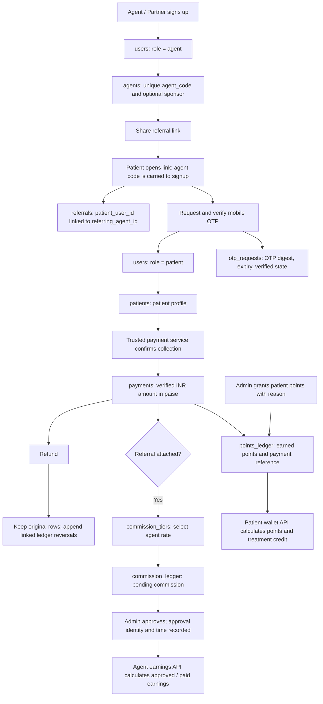

# Kezza PostgreSQL workflow

The mobile app never writes directly to PostgreSQL. It sends authenticated requests to FastAPI; the backend validates the account and business rules, then commits records to the `public` schema of `kezza_db`. DBeaver is the SQL client used to inspect that database.

## End-to-end business flow



### Registration and referral attribution

1. An Agent / Partner account is created through OTP signup. FastAPI writes one `users` row with role `agent` and one `agents` row containing the unique referral code.
2. The Referrals screen creates a link for the current runtime. In Expo Go it targets the current development session; in an installed app it uses the `kezzamobile` scheme. The code arrives as the `ref` query parameter on Patient sign-in.
3. A patient verifies their mobile and completes registration. The backend validates the code and writes `users`, `patients`, and `referrals` in a database transaction. If an Agent already created a lead for that phone, the backend attaches the patient to that existing lead by phone and keeps the original attribution locked.
4. The Agent / Partner sign-in path only authenticates an account whose backend role is `agent`. The role switch previously shown on Profile was a demo-only local toggle and has been removed; changing a display value cannot grant backend permissions.

### Payment, points, and commission

1. A trusted payment source calls the backend only after confirming that the clinic collected payment. The mobile app cannot claim a payment was collected.
2. FastAPI records the payment in `payments`, storing INR as integer paise (`₹1 = 100 paise`). Duplicate payment references are rejected.
3. The backend appends an earning row to `points_ledger`: one eligible whole rupee earns one point. Treatment credit is calculated as 25 points = ₹1.
4. If the patient has a locked referral, the backend marks it converted, selects a rate from `commission_tiers` based on eligible active direct agents, and appends a `pending` row to `commission_ledger`.
5. Admin approval updates the commission's status and records `approved_by_user_id` and `approved_at`. A manual points grant is another `points_ledger` row with `created_by_user_id` and the required reason in its description.
6. Wallets are calculated from ledger rows; there is no mutable wallet-balance table. Refunds preserve the original payment and append linked points and commission reversal rows.

## PostgreSQL tables

| Table | What Kezza stores there |
|---|---|
| `users` | Unique phone identity, name, email, account role, active state, created time. |
| `otp_requests` | Phone, keyed OTP digest (not the plaintext code), expiry, verification state, request time. |
| `patients` | Patient profile keyed to `users`; optional preferred branch. |
| `agents` | Agent profile keyed to `users`, unique agent code, sponsor agent, account status. |
| `referrals` | Patient lead/account, locked referring agent, phone, branch/service, status, conversion time. |
| `branches` | Clinic branch code, name, city, active state. |
| `payments` | Patient, treatment, branch, unique payment reference, currency, amount in minor units, verification/refund state. |
| `points_ledger` | Append-only patient point earnings, manual grants, redemptions and reversals; payment/admin audit links. |
| `commission_tiers` | Current commission rate and minimum eligible direct-agent thresholds. |
| `commission_tiers_legacy` | Preserved historical tier policy. |
| `commission_ledger` | Agent commission, related referral/payment, saved tier snapshot, status, approval and reversal audit links. |
| `alembic_version` | The schema migration revision currently applied to this database. |

The `users.phone_e164` value is unique, and each account has one role (`patient`, `agent`, or `admin`). An existing Patient account cannot be silently turned into an Agent account by choosing a different sign-in button; Agent access must come from an Agent account provisioned through signup or an authorized backend operation.

## Inspecting it in DBeaver

Run these read-only queries against `kezza_db` in the DBeaver SQL Editor:

```sql
SELECT current_database() AS database_name, current_user AS database_user;

SELECT table_name
FROM information_schema.tables
WHERE table_schema = 'public' AND table_type = 'BASE TABLE'
ORDER BY table_name;

SELECT role, COUNT(*) AS account_count
FROM users
GROUP BY role
ORDER BY role;
```

As verified on 2026-11-13, the local development database has two Patient accounts and no Agent accounts, referrals, payments, points entries, or commission entries yet. It has three current commission tiers and four OTP request records. This explains why an existing Agent login is unavailable until an Agent account is registered. Use aggregate queries during routine checks; avoid sharing query results containing patient names or phone numbers.

The applied database revision is `c5f760a25687 (head)`, and `alembic check` reports no schema drift.
